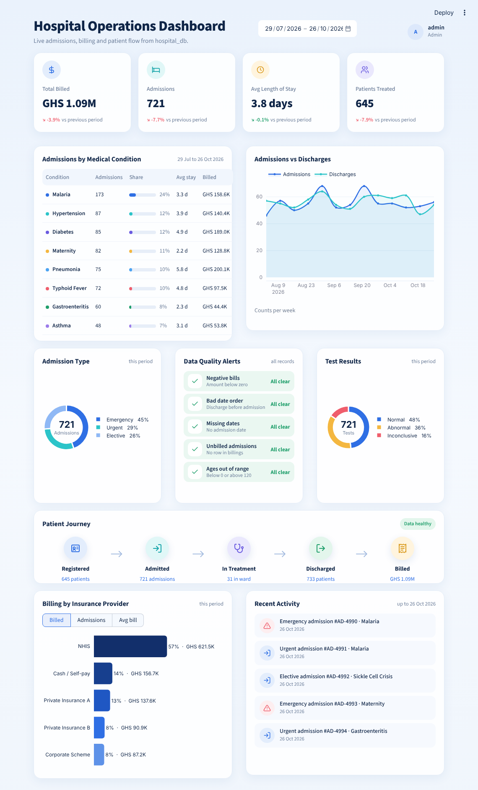

# Hospital Management System and Operations Dashboard

A role-based hospital records system with a live operations dashboard, built with **Python, MySQL and Streamlit**.

**Live demo:** _add your Streamlit link here_
Sign in with any of the demo accounts shown on the login page. The demo uses made-up patients, and anything you add disappears when you close the page.



## The problem

Hospital records often sit in separate spreadsheets and paper files. Front desk staff, doctors, billing officers and managers each need different information, but rarely in one place, and there is usually no record of who looked at which patient file. This project brings registration, patient lookup, billing and management reporting into one system, with access controlled by role.

## What it does

| Feature | Details |
|---|---|
| **Operations dashboard** | KPIs with change versus the previous period (total billed, admissions, average length of stay, patients treated), admissions by condition, admissions versus discharges, admission type, test results, patient journey, billing by insurer, recent activity. Every view follows the date filter. |
| **Find Patient** | Search by name or ID and view the admission and billing history. |
| **Register Patient** | One form creates the patient, admission and bill in a single transaction. Dropdowns keep spellings consistent; validation blocks missing fields, impossible ages, negative bills and discharge dates before admission. |
| **Staff sign-in and roles** | Front desk, doctor, billing and admin each see only their pages and fields. For example, doctors see medication and test results but not bills; billing sees bills but not clinical notes. Passwords are stored as bcrypt hashes. |
| **Audit log** | Records every sign-in, failed sign-in, patient view and new registration with user and time. Admin only. |
| **Data quality alerts** | Live checks for negative bills, impossible dates, unbilled admissions and out-of-range ages. |

## Tools

Python (pandas, SQLAlchemy, Plotly), MySQL 8, Streamlit, bcrypt, Jupyter for data cleaning.

## Database design

Three core tables linked by keys, plus two security tables. Full definitions are in [`schema.sql`](schema.sql).

```
patients (patient_id PK) ──< admissions (admission_id PK, patient_id FK) ──< billings (bill_id PK, admission_id FK)
app_users (user_id PK) ──< audit_log (log_id PK, user_id FK)
```

## Data cleaning and decisions

- Removed duplicates, fixed data types and name formatting, and checked outliers in Jupyter before loading into MySQL.
- **Negative billing amounts:** 106 bills had negative values, which are not valid for a hospital bill. They were backed up to a separate table and set to NULL, so totals and averages exclude them.
- Added CHECK constraints so the database itself rejects negative bills, discharge dates before admission and ages outside 0 to 120.
- Patients still in the ward keep an empty discharge date rather than an invented one.

## Security

- Staff sign in; each role sees only the pages and columns it needs.
- Passwords are hashed with bcrypt, never stored as text.
- The app connects to MySQL with a **least-privilege account** that can read and add records but cannot update, delete, edit the audit log or create users. Root is used only for administration.
- Database credentials live in `.streamlit/secrets.toml`, which is excluded from Git.
- All queries use parameters, not string formatting, to prevent SQL injection.

## Two versions in one repository

| File | Version | Runs on |
|---|---|---|
| `app.py` | **Full system** used locally | MySQL (`hospital_db`) |
| `streamlit_app.py` | **Online demo** | Sample data in a private in-memory database per visitor |

Both use the same `dashboard.py`, the same pages, roles and validation.

## Project structure

```
app.py                  Full MySQL version (dashboard, find, register, login, roles, audit log)
streamlit_app.py        Public demo version (same features, sample data)
dashboard.py            Operations dashboard shared by both
sample_data.py          Generates realistic made-up patients for the demo
sql/
  01_schema.sql         Tables, keys and CHECK constraints
  02_users_and_audit_log.sql   Staff accounts and audit log
  03_app_mysql_user.sql        Least-privilege MySQL account for the app
notebooks/              Data cleaning in Jupyter
tools/
  create_user.py        Creates a staff account with a bcrypt-hashed password
  export_data.py        Exports MySQL tables to data/*.csv
docs/                   Screenshots
```

## Run it yourself

**Online demo version** (no database needed):

```bash
pip install -r requirements.txt
streamlit run streamlit_app.py
```

**Full MySQL version:**

1. Create the database by running the scripts in `sql/` in order (MySQL Workbench or the mysql client).
2. Load the cleaned data into `patients`, `admissions` and `billings`.
3. Copy `.streamlit/secrets.example.toml` to `.streamlit/secrets.toml` and fill in the `hospital_app` password.
4. Run:

```bash
pip install -r requirements.txt
streamlit run app.py
```

## About the online demo

The online version loads the same tables from CSV files (or generated sample data) into a private in-memory database for each visitor, so the public can try every feature without any real patient data and without changing anything permanently. It is a demonstration only and must not be used with real patient information; a real deployment would need hosting on hospital-controlled servers, HTTPS, backups and a review under Ghana's Data Protection Act, 2012 (Act 843).

## Author

Paschal Amenlemah
